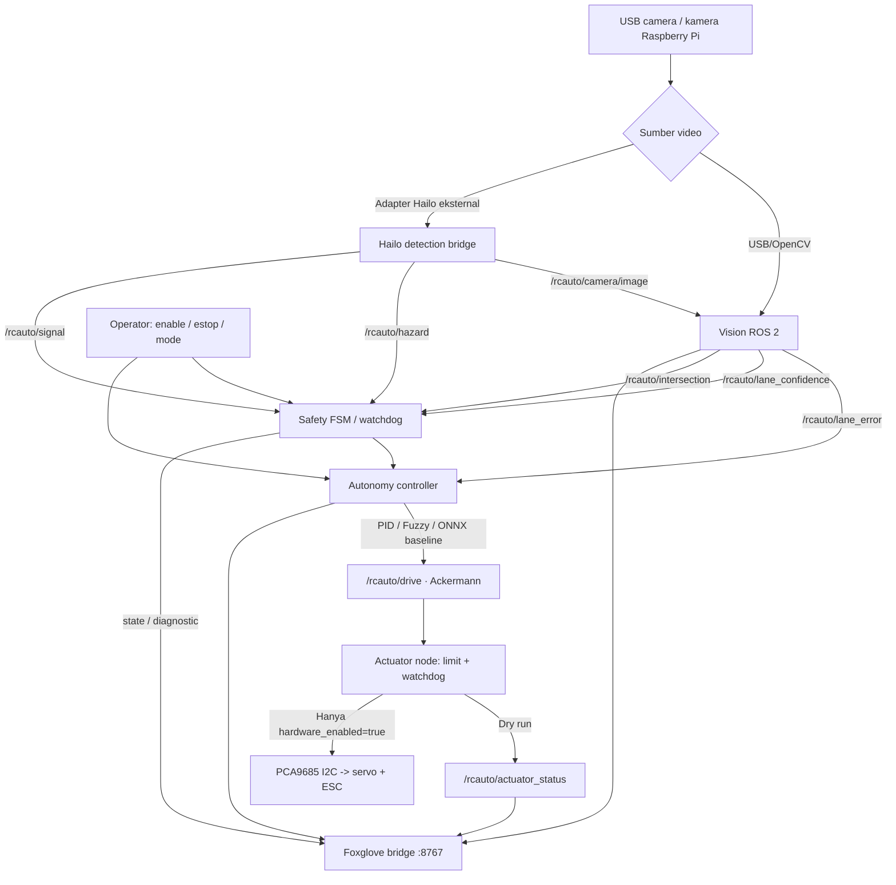
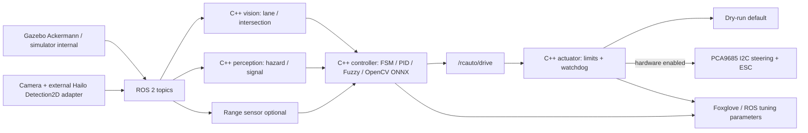

# RCauto — Autonomous RC Vehicle (ROS 2)

**Repository publik:** [rofiqcp/RCauto](https://github.com/rofiqcp/RCauto) · **branch utama:** `v1`

Platform riset mobil RC otonom untuk Raspberry Pi 5 (4 GB) dan akselerator Hailo. Targetnya mengikuti jalur/garis, mendeteksi persimpangan, memeriksa lampu lalu lintas, berhenti saat ada manusia/kendaraan/rintangan, lalu mengendalikan steering servo dan ESC secara terbatas dan aman. ROS 2 dipakai sebagai bus komunikasi; Foxglove untuk observabilitas.

> **Status implementasi:** Paket ROS 2 aktif hanya **`src/rcauto_cpp`** berbasis C++17. Controller, vision, perception, simulator, adapter Gazebo, dan actuator telah berhasil dibangun dari root proyek; unit test dan pengujian aliran sensor simulasi juga berhasil. Paket Python lama sudah dihapus. Integrasi kendaraan fisik dan Hailo belum dinyatakan lulus uji. Model ONNX bawaan adalah *baseline sintetik*, bukan model mengemudi terlatih dari rekaman jalan nyata. Keberhasilan simulasi tidak membuktikan kesiapan operasi mobil fisik.

## 1. Arsitektur dan alur program



### 1.1. State machine keselamatan


**Urutan prioritas:** E-stop → disarm → data sensor hilang/tidak valid → rintangan → lampu di persimpangan → lane following. Hilangnya frame, data hazard yang basi, atau confidence kurang memadai menyebabkan kendaraan berhenti. *Reset* E-stop hanya saat kendaraan tidak armed. Command aktuator yang kedaluwarsa juga menyebabkan keluaran ESC kembali netral.

### 1.2. Jalur C++ utama dan simulator Gazebo



**Hardware C++:** node aktuator menggunakan **PCA9685 melalui I²C** (`/dev/i2c-1`, alamat 0x40, channel 0/1) hanya jika mode hardware diaktifkan. Default **dry-run**. Integrasi Hailo ke `vision_msgs/Detection2DArray` masih membutuhkan adapter eksternal. Keberhasilan build dan simulator tidak membuktikan kesiapan kendaraan fisik.

Build selalu dari root `RCauto/`: `colcon build --base-paths src --packages-select rcauto_cpp --symlink-install`. Source environment `install/setup.bash` di root. Jalankan simulator dengan `./tools/run_simulation.sh`; jangan aktifkan output hardware sebelum uji interlock fisik.

## 2. Struktur repository

```text
RCauto/
├── README.md
├── .gitignore
├── src/
│   ├── rcauto_cpp/                     # satu-satunya paket ROS 2 (C++)
│   │   ├── CMakeLists.txt
│   │   ├── package.xml
│   │   ├── include/rcauto_cpp/
│   │   ├── src/                        # node C++ dan adapter Gazebo
│   │   ├── config/robot.yaml
│   │   ├── launch/                     # ROS 2 launch
│   │   ├── sim/                        # simulator Gazebo Ackermann
│   │   └── test/
│   ├── foxglove/
│   ├── models/
│   ├── recordings/
│   └── tools -> ../tools               # symlink ke tools root
├── tools/
├── referensi/github/                  # repositori penelitian lokal
├── build/                             # hasil colcon (root)
├── install/                           # hasil colcon (root)
└── log/                               # hasil colcon (root)
```

Paket sumber berada langsung di `src/rcauto_cpp/`. Folder `src/ros2_ws/` sudah dihapus. Referensi, rekaman, hasil build, cache dan data lokal tidak diunggah ke Git. Semua build wajib dijalankan dari root `RCauto/`.

## 3. Instalasi pada PC Linux baru — Ubuntu 24.04 LTS (amd64 atau arm64)

Untuk pengembangan PC, gunakan **Ubuntu 24.04 + ROS 2 Jazzy**. Untuk Ubuntu 22.04, gunakan ROS 2 Humble dan ganti nama paket `jazzy` menjadi `humble`. Ikuti [panduan resmi pemasangan ROS 2 Jazzy](https://docs.ros.org/en/jazzy/Installation/Ubuntu-Install-Debs.html) apabila konfigurasi repositori berubah.

### 3.1. Dependensi sistem dan ROS 2

```bash
sudo apt update
sudo apt install -y locales software-properties-common curl git ca-certificates
sudo locale-gen en_US en_US.UTF-8
sudo update-locale LANG=en_US.UTF-8
sudo add-apt-repository -y universe

# Pasang sumber APT ROS 2 menggunakan paket resmi ROS.
export ROS_APT_SOURCE_VERSION="$(curl -fsSL https://api.github.com/repos/ros-infrastructure/ros-apt-source/releases/latest | grep -F '"tag_name"' | head -1 | cut -d '"' -f4)"
curl -fL -o /tmp/ros2-apt-source.deb "https://github.com/ros-infrastructure/ros-apt-source/releases/download/${ROS_APT_SOURCE_VERSION}/ros2-apt-source_${ROS_APT_SOURCE_VERSION}.$(. /etc/os-release && echo ${UBUNTU_CODENAME:-${VERSION_CODENAME}})_all.deb"
sudo dpkg -i /tmp/ros2-apt-source.deb
sudo apt update

sudo apt install -y ros-jazzy-ros-base ros-jazzy-ackermann-msgs \
  ros-jazzy-foxglove-bridge ros-jazzy-cv-bridge \
  python3-colcon-common-extensions python3-rosdep \
  python3-opencv python3-numpy python3-pytest python3-pip
source /opt/ros/jazzy/setup.bash
ros2 --help
```

Jika ada paket yang tidak ditemukan, pastikan sumber ROS telah aktif dan Ubuntu sesuai rilis ROS; lihat panduan resmi di atas. Perintah instalasi ini ditujukan untuk Ubuntu, **bukan** Raspberry Pi OS (Debian).

### 3.2. Clone branch `v1` dan build C++ dari root

```bash
mkdir -p ~/projects
cd ~/projects
git clone --branch v1 --single-branch https://github.com/rofiqcp/RCauto.git
cd RCauto
source /opt/ros/humble/setup.bash  # Ubuntu 22.04; gunakan jazzy pada Ubuntu 24.04
colcon build --base-paths src --packages-select rcauto_cpp --symlink-install
source install/setup.bash
ros2 pkg executables rcauto_cpp
```

Tidak ada paket Python ROS 2 lama. Pada sistem baru, sesuaikan dependensi ROS 2 dengan versi Ubuntu. Folder `build/`, `install/`, dan `log/` otomatis dibuat pada root proyek. File `*.launch.py` diperlukan untuk mekanisme launch ROS 2, bukan node aplikasi Python.

### 3.3. Simulasi aman di PC

```bash
cd ~/projects/RCauto
bash tools/run_simulation.sh
```

Default adalah simulasi Gazebo Harmonic menggunakan arena KSTI 2026 yang direkonstruksi dari foto, dengan **lebar lintasan 50 cm**, dimensi luar perkiraan **5,01 × 6,34 m**, garis tepi putih, garis tengah putih putus-putus, dan logo tengah. Model kendaraan fisika Ackermann 35 × 20 cm memakai kamera, LiDAR, dan odometri. Tampilan arena dari atas tersedia pada `/rcauto/arena/overview` di Foxglove. File world ada di `src/rcauto_cpp/sim/rcauto_track.sdf`; tekstur dan mesh ada di `src/rcauto_cpp/sim/ksti2026_arena/`. Berkas `sim/maps/ksti2026_f1tenth.yaml` + `.png` adalah peta okupansi yang dapat dipakai pada F1TENTH kompatibel, sedangkan `sim/maps/ksti2026_centerline.csv` berisi waypoint lintasan. Pengujian nyata dilakukan di Gazebo; simulator F1TENTH ROS 2 Jazzy belum diuji pada komputer Humble. Bila tanpa `DISPLAY`, skrip memakai Xvfb/renderer software. Alternatif simulator sintetis: `RCAUTO_SIM_BACKEND=synthetic ./tools/run_simulation.sh`. **Keluaran servo/ESC fisik tetap nonaktif (dry-run)**. Uji bergerak di arena mencapai sekitar 1,83 m, lalu berhenti aman saat garis hilang; satu putaran penuh masih memerlukan peningkatan kontrol. Terminal baru untuk inspeksi:

```bash
source /opt/ros/jazzy/setup.bash
source ~/projects/RCauto/install/setup.bash
ros2 topic list
ros2 topic echo /rcauto/status
ros2 topic echo /rcauto/actuator_status
ros2 topic pub --once /rcauto/operator/enable std_msgs/msg/Bool '{data: true}'
# Hentikan:
ros2 topic pub --once /rcauto/operator/estop std_msgs/msg/Bool '{data: true}'
```

Konfigurasi awal `hardware_enabled=false`. Untuk mengetes perubahan algoritma, jalankan dulu di simulasi sambil memonitor `/rcauto/status`.

## 4. Foxglove: monitoring dan tuning

1. Jalankan simulasi. Bridge berjalan pada alamat `127.0.0.1:8767` melalui WebSocket.
2. Di [Foxglove](https://foxglove.dev/), buka koneksi **Foxglove WebSocket** ke `ws://127.0.0.1:8767` (satu PC).
3. Import layout `src/foxglove/rcauto_layout.json`, kemudian pantau image, lane offset/confidence, hazard, traffic light, drive, state, serta status aktuator.
4. Mode kendali dapat diubah saat **disarmed** melalui `/rcauto/operator/mode` (String: `pid`, `fuzzy`, atau `ai` jika model ONNX berhasil dimuat melalui OpenCV DNN). Parameter dasar ada di `src/rcauto_cpp/config/robot.yaml`.

Topik penting:

| Topik ROS 2 | Tipe | Fungsi |
| --- | --- | --- |
| `/rcauto/camera/image` | `sensor_msgs/Image` | Frame sensor dari simulator/Hailo |
| `/rcauto/camera/annotated` | `sensor_msgs/Image` | Overlay lane |
| `/rcauto/lane_error` | `std_msgs/Float32` | Deviasi normalisasi |
| `/rcauto/lane_confidence` | `std_msgs/Float32` | Confidence lane |
| `/rcauto/intersection` | `std_msgs/Bool` | Deteksi persimpangan |
| `/rcauto/hazard` | `std_msgs/Bool` | Deteksi potensi tabrakan |
| `/rcauto/signal` | `std_msgs/String` | RED/YELLOW/GREEN/UNKNOWN |
| `/rcauto/operator/enable` | `std_msgs/Bool` | Arming perangkat lunak |
| `/rcauto/operator/estop` | `std_msgs/Bool` | E-stop software latched |
| `/rcauto/operator/reset_estop` | `std_msgs/Bool` | Reset saat disarmed |
| `/rcauto/operator/mode` | `std_msgs/String` | Ganti mode saat disarmed |
| `/rcauto/drive` | `ackermann_msgs/AckermannDriveStamped` | Speed/steering command |
| `/rcauto/status` | `std_msgs/String` | Status FSM |
| `/rcauto/actuator_status` | `std_msgs/String` | PWM/dry run dan watchdog |

Untuk akses Foxglove dari PC lain, alamat bind perlu diatur secara eksplisit dan jaringan diamankan; jangan publikasikan port bridge tanpa autentikasi atau firewall.

## 5. Raspberry Pi 5 + Hailo + servo + ESC

`tools/run_pi5.sh` menjalankan paket C++ yang sama dengan simulator. Build dilakukan dari **root RCauto**. Default `RCAUTO_HW_OUTPUT=false`, sehingga tidak ada keluaran ESC atau servo fisik. Untuk sensor AI HAT/Hailo, diperlukan **adapter ROS 2 eksternal** yang menerbitkan `vision_msgs/Detection2DArray`; pemasangan Hailo sendiri belum membuktikan adapter kompatibel.

Node aktuator C++ menggunakan PCA9685 via I²C (default `/dev/i2c-1`, alamat `0x40`, channel steering 0 dan ESC 1), bukan GPIO PWM paket Python lama. Parameter pulse/kecepatan adalah titik awal kalibrasi, bukan jaminan cocok bagi perangkat tertentu. Gunakan catu daya motor terpisah, GND sinyal yang benar, kalibrasi serta pengaman listrik.

Pengaktifan keluaran fisik hanya untuk pengujian pada workbench dengan roda terangkat, pemutus darurat eksternal, dan pengawasan operator. Skrip menolak output langsung kecuali ada pengakuan eksplisit `RCAUTO_LIVE_ACK=CONFIRM_WHEELS_UP_EXTERNAL_ESTOP`; konfirmasi perangkat lunak tidak menggantikan pengaman fisik.

## 6. Pengujian

```bash
source /opt/ros/humble/setup.bash  # atau jazzy pada Ubuntu 24.04
cd ~/projects/RCauto
colcon build --base-paths src --packages-select rcauto_cpp --symlink-install
ctest --test-dir build/rcauto_cpp --output-on-failure
source install/setup.bash
ros2 pkg executables rcauto_cpp
```

Build setelah pemindahan direktori telah berhasil dari root proyek, termasuk keenam executable C++ dan unit test `rcauto_core_test`. Launcher Gazebo, validasi SDF, aliran kamera, LiDAR dan odometri telah diuji pada komputer `sirobo`. Ini belum merupakan uji integrasi Hailo maupun kendaraan fisik. Mode AI menggunakan model ONNX melalui OpenCV DNN; model baseline masih sintetis.

## 7. Peta pengembangan

- Lanjutkan pengujian kendali dan persepsi di Gazebo dengan model Ackermann yang telah terpasang pada `src/rcauto_cpp/sim/`, termasuk lintasan, lampu dan rintangan.
- Validasi model Hailo sesuai kamera dan AI HAT, serta deteksi pejalan kaki/kendaraan/lampu nyata dengan dataset sendiri.
- Kalibrasi steering/ESC Pi 5, failsafe listrik independen, pengukuran latency dan watchdog end-to-end.
- Pengujian jalur/perempatan berulang, kriteria berhenti/melintas, telemetry Foxglove, dan logging pengujian ke lokasi **lokal** yang tidak ikut Git.

## 8. Referensi dan lisensi

Rujukan utama: [ROS 2 Jazzy](https://docs.ros.org/en/jazzy/), [Foxglove Bridge](https://docs.foxglove.dev/docs/connecting-to-data/ros-foxglove-bridge), [Raspberry Pi Hailo AI](https://www.raspberrypi.com/documentation/computers/ai.html). Metadata paket menyatakan Apache-2.0; berkas lisensi root belum disertakan karena ruang lingkup publikasi saat ini dibatasi pada `src/`, `tools/`, `README.md` dan `.gitignore`.
