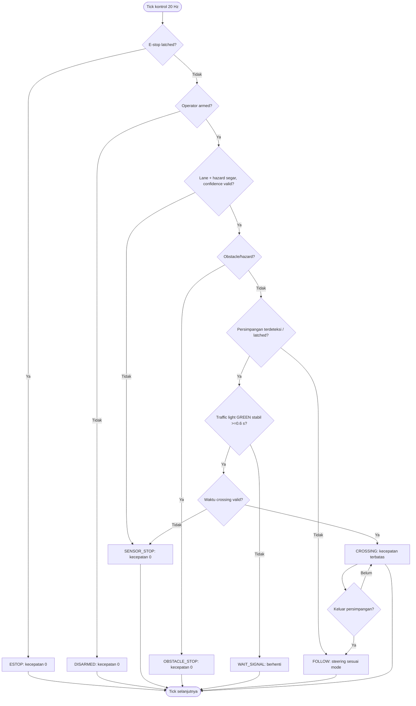

# RCauto — Autonomous RC Vehicle (ROS 2)

**Repository publik:** [rofiqcp/RCauto](https://github.com/rofiqcp/RCauto) · **branch utama:** `v1`

Platform riset mobil RC otonom untuk Raspberry Pi 5 (4 GB) dan akselerator Hailo. Targetnya mengikuti jalur/garis, mendeteksi persimpangan, memeriksa lampu lalu lintas, berhenti saat ada manusia/kendaraan/rintangan, lalu mengendalikan steering servo dan ESC secara terbatas dan aman. ROS 2 dipakai sebagai bus komunikasi; Foxglove untuk observabilitas.

> **Status implementasi:** Paket ROS 2 Python `rcauto` menyediakan node, logika kontrol, simulasi dan tes. Paket `rcauto_cpp` telah berisi implementasi C++ awal (`controller`, `vision`, `perception`, `simulator`, `actuator`), tetapi **build, integrasi dan hardware-nya belum diverifikasi dalam panduan ini**. Untuk instalasi awal, gunakan paket Python `rcauto` terlebih dahulu. Model ONNX bawaan adalah *baseline sintetik*, bukan model mengemudi terlatih dari rekaman jalan nyata. Keberhasilan simulasi tidak membuktikan kesiapan operasi mobil fisik.

## 1. Arsitektur dan alur program

```mermaid
flowchart TD
    C[USB camera / kamera Raspberry Pi] --> SELECT{Sumber video}
    SELECT -->|USB/OpenCV| VIS[Vision ROS 2]
    SELECT -->|Hailo GStreamer| H[Hailo detection bridge]
    H -->|/rcauto/camera/image| VIS
    H -->|/rcauto/hazard| SAFE
    H -->|/rcauto/signal| SAFE
    VIS -->|/rcauto/lane_error| CTRL
    VIS -->|/rcauto/lane_confidence| SAFE
    VIS -->|/rcauto/intersection| SAFE
    SAFE[Safety FSM / watchdog] --> CTRL[Autonomy controller]
    OP[Operator: enable / estop / mode] --> SAFE
    OP --> CTRL
    CTRL -->|PID / Fuzzy / ONNX baseline| DRIVE[/rcauto/drive Ackermann]
    DRIVE --> ACT[Actuator node: limit + watchdog]
    ACT -->|Dry run| STATUS[/rcauto/actuator_status]
    ACT -->|Hanya hardware_enabled=true| PWM[GPIO PWM -> servo + ESC]
    SAFE -->|state / diagnostic| MON[Foxglove bridge :8767]
    CTRL --> MON
    VIS --> MON
    STATUS --> MON
```

### 1.1. State machine keselamatan



**Urutan prioritas:** E-stop → disarm → data sensor hilang/tidak valid → rintangan → lampu di persimpangan → lane following. Hilangnya frame, data hazard yang basi, atau confidence kurang memadai menyebabkan kendaraan berhenti. *Reset* E-stop hanya saat kendaraan tidak armed. Command aktuator yang kedaluwarsa juga menyebabkan keluaran ESC kembali netral.

### 1.2. Jalur C++ (pengembangan, terpisah dari paket Python)

```mermaid
flowchart LR
    SIM[C++ simulator: image / detections / range] --> BUS[ROS 2 topics]
    REAL[Camera + external Hailo Detection2D adapter] --> BUS
    BUS --> V[C++ vision: lane / intersection]
    BUS --> P[C++ perception: hazard / signal]
    BUS --> R[Range sensor optional]
    V --> F[C++ controller: FSM / PID / Fuzzy / OpenCV ONNX]
    P --> F
    R --> F
    F --> D[/rcauto/drive]
    D --> A[C++ actuator: limits + watchdog]
    A --> DRY[Dry-run default]
    A -->|hardware enabled| I2C[PCA9685 I2C steering + ESC]
    F --> FG[Foxglove / ROS tuning parameters]
    A --> FG
```

**Perbedaan hardware:** node aktuator **Python** menggunakan GPIO PWM melalui `lgpio` (BCM18/BCM19), sedangkan aktuator **C++** saat ini menggunakan **PCA9685 melalui I²C** (`/dev/i2c-1`, alamat 0x40, channel 0/1) jika mode hardware diaktifkan. Jangan menjalankan kedua aktuator ke ESC yang sama bersamaan. Produksi deteksi Hailo ke `vision_msgs/Detection2DArray` untuk jalur C++ memerlukan adapter eksternal yang cocok dengan runtime Hailo. Node C++ dan pipeline gabungannya belum dikonfirmasi lulus build atau uji kendaraan.

Jika ingin mencoba build paket C++ secara terpisah di Ubuntu 24.04, pasang pula `ros-jazzy-vision-msgs`, `ros-jazzy-diagnostic-msgs`, `libopencv-dev`, dan `libi2c-dev`, lalu jalankan dari `src/ros2_ws`: `colcon build --packages-select rcauto_cpp`. Perbaiki error build yang ditemukan sebelum menjalankan node.

## 2. Struktur repository

```text
RCauto/
├── README.md
├── .gitignore
├── src/
│   ├── foxglove/rcauto_layout.json      # layout panel
│   ├── models/line_policy_baseline.onnx # model steering sintetis
│   ├── ros2_ws/
│   │   └── src/
│   │       ├── rcauto/                  # paket ROS 2 Python, aktif
│   │       │   ├── rcauto/              # vision, Hailo, control, actuator, simulation
│   │       │   ├── config/robot.yaml
│   │       │   ├── launch/rcauto.launch.py
│   │       │   └── test/
│   │       └── rcauto_cpp/              # C++ dalam pengembangan
│   └── tools -> ../tools               # alias kompatibilitas jalur lama
└── tools/
    ├── preflight.py
    ├── run_simulation.sh
    ├── run_pi5.sh
    ├── train_ai.py
    ├── collect_github.py
    ├── collect_papers.py
    └── enrich_oa_pdfs.py
```

Direktori `referensi/`, `docs/`, rekaman kamera, dataset, hasil build `build/install/log`, cache, kredensial, dan file temporer **tidak diunggah ke GitHub**. Alias `src/tools` adalah symlink untuk kompatibilitas, bukan salinan program kedua.

## 3. Instalasi pada PC Linux baru — Ubuntu 24.04 LTS (amd64 atau arm64)

Untuk pengembangan PC, gunakan **Ubuntu 24.04 + ROS 2 Jazzy**. Untuk Ubuntu 22.04, gunakan ROS 2 Humble dan ganti nama paket `jazzy` menjadi `humble`. Ikuti [panduan resmi pemasangan ROS 2 Jazzy](https://docs.ros.org/en/jazzy/Installation/Ubuntu-Install-Debs.html) apabila konfigurasi repositori berubah.

### 3.1. Dependensi sistem dan ROS 2

```bash
sudo apt update
sudo apt install -y locales software-properties-common curl git ca-certificates
sudo locale-gen en_US en_US.UTF-8
sudo update-locale LANG=en_US.UTF-8
sudo add-apt-repository -y universe

# Pasang sumber APT ROS 2 menggunakan paket resmi ROS.
export ROS_APT_SOURCE_VERSION="$(curl -fsSL https://api.github.com/repos/ros-infrastructure/ros-apt-source/releases/latest | grep -F '"tag_name"' | head -1 | cut -d '"' -f4)"
curl -fL -o /tmp/ros2-apt-source.deb "https://github.com/ros-infrastructure/ros-apt-source/releases/download/${ROS_APT_SOURCE_VERSION}/ros2-apt-source_${ROS_APT_SOURCE_VERSION}.$(. /etc/os-release && echo ${UBUNTU_CODENAME:-${VERSION_CODENAME}})_all.deb"
sudo dpkg -i /tmp/ros2-apt-source.deb
sudo apt update

sudo apt install -y ros-jazzy-ros-base ros-jazzy-ackermann-msgs \
  ros-jazzy-foxglove-bridge ros-jazzy-cv-bridge \
  python3-colcon-common-extensions python3-rosdep \
  python3-opencv python3-numpy python3-pytest python3-pip
source /opt/ros/jazzy/setup.bash
ros2 --help
```

Jika ada paket yang tidak ditemukan, pastikan sumber ROS telah aktif dan Ubuntu sesuai rilis ROS; lihat panduan resmi di atas. Perintah instalasi ini ditujukan untuk Ubuntu, **bukan** Raspberry Pi OS (Debian).

### 3.2. Clone branch `v1`, build paket Python

```bash
mkdir -p ~/projects
cd ~/projects
git clone --branch v1 --single-branch https://github.com/rofiqcp/RCauto.git
cd RCauto
python3 tools/preflight.py
source /opt/ros/jazzy/setup.bash
cd src/ros2_ws
colcon build --packages-select rcauto --symlink-install
source install/setup.bash
ros2 pkg executables rcauto
```

Untuk instalasi awal, gunakan `--packages-select rcauto`; paket C++ memerlukan pemeriksaan dependensi dan build terpisah. Build tidak mengaktifkan GPIO kendaraan. Untuk shell baru, jalankan lagi `source /opt/ros/jazzy/setup.bash` dan `source ~/projects/RCauto/src/ros2_ws/install/setup.bash`.

### 3.3. Simulasi aman di PC

```bash
cd ~/projects/RCauto
bash tools/run_simulation.sh
```

Simulasi menerbitkan kamera virtual, hazard=false, signal=UNKNOWN dan menggunakan jalur ROS. **Keluaran servo/ESC selalu nonaktif**. Terminal baru untuk inspeksi:

```bash
source /opt/ros/jazzy/setup.bash
source ~/projects/RCauto/src/ros2_ws/install/setup.bash
ros2 topic list
ros2 topic echo /rcauto/status
ros2 topic echo /rcauto/actuator_status
ros2 topic pub --once /rcauto/operator/enable std_msgs/msg/Bool '{data: true}'
# Hentikan:
ros2 topic pub --once /rcauto/operator/estop std_msgs/msg/Bool '{data: true}'
```

Konfigurasi awal `hardware_enabled=false`. Untuk mengetes perubahan algoritma, jalankan dulu di simulasi sambil memonitor `/rcauto/status`.

## 4. Foxglove: monitoring dan tuning

1. Jalankan simulasi. Bridge berjalan pada alamat `127.0.0.1:8767` melalui WebSocket.
2. Di [Foxglove](https://foxglove.dev/), buka koneksi **Foxglove WebSocket** ke `ws://127.0.0.1:8767` (satu PC).
3. Import layout `src/foxglove/rcauto_layout.json`, kemudian pantau image, lane offset/confidence, hazard, traffic light, drive, state, serta status aktuator.
4. Mode kendali dapat diubah saat **disarmed** melalui `/rcauto/operator/mode` (String: `pid`, `fuzzy`, atau `ai` jika ONNX Runtime siap). Parameter dasar ada di `src/ros2_ws/src/rcauto/config/robot.yaml`.

Topik penting:

| Topik ROS 2 | Tipe | Fungsi |
| --- | --- | --- |
| `/rcauto/camera/image` | `sensor_msgs/Image` | Frame sensor dari simulator/Hailo |
| `/rcauto/camera/annotated` | `sensor_msgs/Image` | Overlay lane |
| `/rcauto/lane_error` | `std_msgs/Float32` | Deviasi normalisasi |
| `/rcauto/lane_confidence` | `std_msgs/Float32` | Confidence lane |
| `/rcauto/intersection` | `std_msgs/Bool` | Deteksi persimpangan |
| `/rcauto/hazard` | `std_msgs/Bool` | Deteksi potensi tabrakan |
| `/rcauto/signal` | `std_msgs/String` | RED/YELLOW/GREEN/UNKNOWN |
| `/rcauto/operator/enable` | `std_msgs/Bool` | Arming perangkat lunak |
| `/rcauto/operator/estop` | `std_msgs/Bool` | E-stop software latched |
| `/rcauto/operator/reset_estop` | `std_msgs/Bool` | Reset saat disarmed |
| `/rcauto/operator/mode` | `std_msgs/String` | Ganti mode saat disarmed |
| `/rcauto/drive` | `ackermann_msgs/AckermannDriveStamped` | Speed/steering command |
| `/rcauto/status` | `std_msgs/String` | Status FSM |
| `/rcauto/actuator_status` | `std_msgs/String` | PWM/dry run dan watchdog |

Untuk akses Foxglove dari PC lain, alamat bind perlu diatur secara eksplisit dan jaringan diamankan; jangan publikasikan port bridge tanpa autentikasi atau firewall.

## 5. Raspberry Pi 5 + Hailo + servo + ESC

**Penting:** Linux PC Ubuntu dan Raspberry Pi OS tidak memiliki jalur instalasi ROS/Hailo yang otomatis identik. Raspberry Pi OS 64-bit adalah sistem yang didukung resmi untuk AI HAT+; panduan Hailo/driver dan ROS 2 pada Pi harus cocok dengan OS serta arsitektur. Referensi: [Raspberry Pi AI Software](https://www.raspberrypi.com/documentation/computers/ai.html) dan [Hailo Apps](https://github.com/hailo-ai/hailo-apps).

1. Pasang Raspberry Pi 5, AI HAT/Hailo dan kamera menurut dokumentasi produsennya. Gunakan catu daya Pi dan catu ESC terpisah sesuai spesifikasi; **satukan GND sinyal** dan pastikan input servo/ESC menerima logika 3,3 V.
2. Pada Raspberry Pi OS yang didukung, pasang driver Hailo (AI Kit/AI HAT+: `sudo apt install dkms hailo-all`; AI HAT+ 2: `sudo apt install dkms hailo-h10-all`, bukan keduanya). Reboot dan jalankan `hailortcli fw-control identify`; uji kamera dengan `rpicam-hello`.
3. Node `hailo_bridge` memerlukan runtime Python `hailo_apps` dan GStreamer yang kompatibel; **tidak otomatis tersedia hanya dengan `hailo-all`**. Ikuti pemasangan Hailo Apps untuk perangkat/OS yang dipakai. Verifikasi `python3 tools/preflight.py`.
4. Pasang ROS 2 dan dependensi proyek pada sistem yang kompatibel, build paket `rcauto` dengan colcon seperti bagian 3. Jalankan dulu dengan `hardware_enabled:=false` dan `RCAUTO_USE_HAILO=false`, lalu uji input kamera/Hailo secara terpisah.
5. Jalur awal **paket Python** pada `robot.yaml`: **steering GPIO BCM18**, **ESC GPIO BCM19**; pulse default steering center 1500 µs (1100–1900), ESC netral 1500 µs, maju maksimum 1600 µs. Ini adalah **konfigurasi awal untuk kalibrasi**, bukan jaminan cocok untuk ESC/servo tertentu. Periksa nomor `gpiochip`, mapping GPIO Pi 5, permission perangkat, rentang pulsa, serta persyaratan `lgpio` pada hardware nyata.
6. Tidak boleh mengaktifkan motor tanpa roda terangkat, kill switch fisik dan batas arus/kecepatan yang benar. Sakelar pemutus daya motor fisik harus tersedia di luar jalur ROS dan aplikasi.

Setelah validasi terpisah dan hardware betul-betul aman, skrip `tools/run_pi5.sh` mendukung environment `RCAUTO_MODE`, `RCAUTO_LANE_STYLE`, `RCAUTO_USE_HAILO`, `RCAUTO_HW_OUTPUT` dan `RCAUTO_FOXGLOVE_ADDRESS`. Secara default, output PWM **off**. Skrip menolak PWM live jika `RCAUTO_LIVE_ACK` tidak diatur tepat `WHEELS_UP_ESC_CALIBRATED`. Pengaturan acknowledgement ini **bukan pengganti interlock fisik**.

## 6. Pengujian

```bash
cd ~/projects/RCauto
python3 -m compileall -q src/ros2_ws/src/rcauto tools
source /opt/ros/jazzy/setup.bash
cd src/ros2_ws
colcon test --packages-select rcauto
colcon test-result --verbose
```

Tes Python mencakup logika state machine dan persepsi. Tes hardware Raspberry Pi/Hailo/servo/ESC dan mutu deteksi di lingkungan nyata belum dapat dianggap lulus hanya berdasarkan uji unit/simulasi. Mode `ai` memerlukan `onnxruntime` dan model ONNX sesuai arsitektur Python/CPU; baseline bawaan dilatih dari target sintetis (`tools/train_ai.py`).

## 7. Peta pengembangan

- Memvalidasi build dan integrasi node C++ (`controller`, `vision`, `perception`, `simulator`, `actuator`), melengkapi launch/config/tes, lalu menguji kesetaraan terhadap paket Python.
- Validasi model Hailo sesuai kamera dan AI HAT, serta deteksi pejalan kaki/kendaraan/lampu nyata dengan dataset sendiri.
- Kalibrasi steering/ESC Pi 5, failsafe listrik independen, pengukuran latency dan watchdog end-to-end.
- Pengujian jalur/perempatan berulang, kriteria berhenti/melintas, telemetry Foxglove, dan logging pengujian ke lokasi **lokal** yang tidak ikut Git.

## 8. Referensi dan lisensi

Rujukan utama: [ROS 2 Jazzy](https://docs.ros.org/en/jazzy/), [Foxglove Bridge](https://docs.foxglove.dev/docs/connecting-to-data/ros-foxglove-bridge), [Raspberry Pi Hailo AI](https://www.raspberrypi.com/documentation/computers/ai.html). Metadata paket menyatakan Apache-2.0; berkas lisensi root belum disertakan karena ruang lingkup publikasi saat ini dibatasi pada `src/`, `tools/`, `README.md` dan `.gitignore`.
